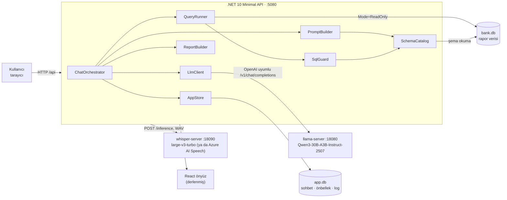
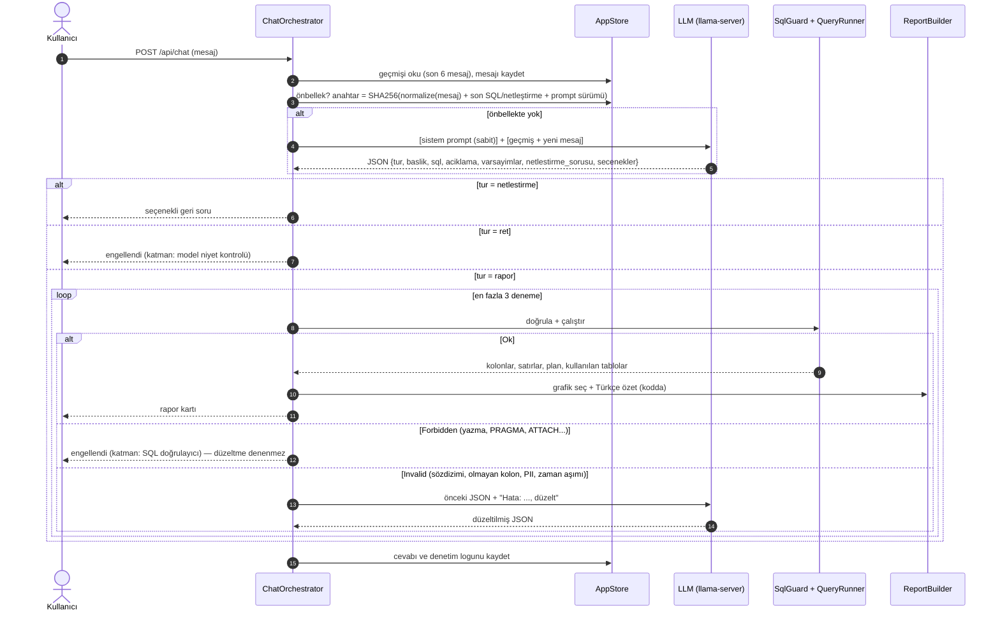
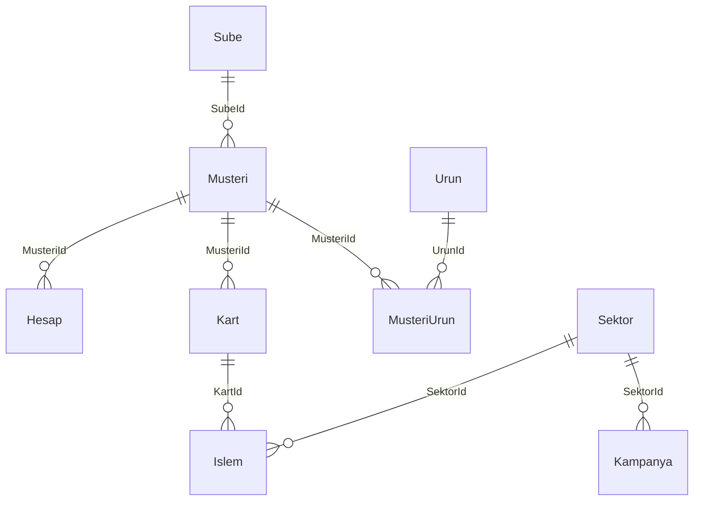

# Diyalog 360 — Mimari Doküman

> Bu doküman **uygulanmış** sistemi anlatır. Kök dizindeki PDF ilk planı (Claude API, SQL Server, ScriptDom) içerir;
> uygulamada bunların yerine yerel model, SQLite ve SQLite authorizer kullanıldı. Farklar [§11](#11-ilk-plandan-farklar)'de.

## İçindekiler
1. [Amaç ve kapsam](#1-amaç-ve-kapsam)
2. [Bileşenler](#2-bileşenler)
3. [İstek akışı](#3-istek-akışı)
4. [Backend modülleri](#4-backend-modülleri)
5. [LLM katmanı ve prompt tasarımı](#5-llm-katmanı-ve-prompt-tasarımı)
6. [Güvenlik](#6-güvenlik)
7. [Veri modeli](#7-veri-modeli)
8. [Önyüz](#8-önyüz)
9. [Kalite: test ve eval](#9-kalite-test-ve-eval)
10. [Yapılandırma, çalıştırma, performans](#10-yapılandırma-çalıştırma-performans)
11. [İlk plandan farklar](#11-ilk-plandan-farklar)
12. [Tasarım kararları](#12-tasarım-kararları)
13. [Bilinen sınırlar ve sonraki adımlar](#13-bilinen-sınırlar-ve-sonraki-adımlar)

---

## 1. Amaç ve kapsam

SQL bilmeyen iş kullanıcısının Türkçe sorduğu rapor isteğini veritabanı şemasını bilerek SQL'e çevirmek, sorguyu
güvenle çalıştırmak ve sonucu **grafik + tablo + Türkçe özet** olarak sunmak. Tek seferlik soru-cevap değil, **diyalog**:
takip sorusuyla rapor daraltılır, belirsiz soruda sistem geri soru sorar, üretilen SQL her zaman açıklamasıyla görünür.

| Kapsamda | Kapsam dışı |
|---|---|
| Türkçe soru → SQL → sonuç, takip soruları, netleştirme | Çok kullanıcılı yönetim, rol bazlı yetki, SSO |
| Salt-okuma doğrulaması, KVKK kolon engeli, denetim logu | Veri yazma/güncelleme |
| Otomatik grafik, Türkçe özet, CSV dışa aktarma | Aynı anda birden fazla veritabanı |
| Elle SQL düzenleyip çalıştırma (aynı doğrulamayla) | Model fine-tuning |
| Tek kullanıcılı giriş/çıkış, Geçmiş Sorgularım menüsü, sesle soru (Türkçe) | Çok kullanıcı, kullanıcı yönetim ekranı |
| Tamamen yerel çalışma (internet gerekmez) | Bulut dağıtımı |

**Temel ilke:** LLM yalnızca SQL *önerir*; neyin çalışacağına LLM'den bağımsız, deterministik kod karar verir.

---

## 2. Bileşenler



| Bileşen | Teknoloji | Görev |
|---|---|---|
| Önyüz | React 19, TypeScript, Vite, Tailwind CSS 4, Recharts | Sohbet, rapor kartı, SQL paneli, veri kataloğu |
| API | .NET 10 Minimal API, Microsoft.Data.Sqlite (SQLitePCLRaw) | Akış yönetimi, doğrulama, çalıştırma, raporlama |
| Ses tanıma (opsiyonel) | whisper.cpp `whisper-server` + `ggml-large-v3-turbo-q5_0` ya da Azure AI Speech | Konuşma → Türkçe metin |
| Model sunucusu | llama.cpp `llama-server`, Qwen3-30B-A3B-Instruct-2507 (IQ4_XS GGUF) | Soru → yapılandırılmış JSON (SQL, açıklama, netleştirme) |
| Rapor veritabanı | SQLite `api/Data/bank.db` | Banka demo verisi; yalnızca okunur |
| Uygulama veritabanı | SQLite `api/Data/app.db` (WAL) | Sohbet geçmişi, LLM cevap önbelleği, denetim logu |

### API uçları

Tüm `/api` uçları giriş gerektirir (girişsiz 401); yalnızca `/api/auth/*` anonimdir.

| Uç | Açıklama |
|---|---|
| `POST /api/auth/login` `{username, password}` | Giriş; başarıda oturum çerezi. 401 hatalı · 429 kilit/hız sınırı · 503 kullanıcı tanımsız |
| `POST /api/auth/logout` | Oturumu sunucuda siler, çerezi temizler |
| `GET /api/auth/me` | Oturum açıksa kullanıcı adı; değilse 401 + `configured` (kullanıcı tanımlı mı) |
| `POST /api/chat` `{chatId?, message}` | Ana akış. Cevap: `report` · `clarify` · `blocked` · `error` |
| `POST /api/sql` `{chatId?, sql}` | Elle düzenlenen SQL'i LLM'siz, aynı doğrulamadan geçirerek çalıştırır |
| `GET /api/history/{chatId}` | Sohbet geçmişi (kullanıcı metinleri + kayıtlı cevaplar) |
| `POST /api/speech` (multipart `audio`, WAV ≤5 MB, `X-Diyalog360: 1` başlığı) | Sesi yazıya döker: `{text, provider, durationMs}`; sağlayıcı kapalıysa 503 |
| `DELETE /api/chats/{chatId}` | Sohbeti ve mesajlarını siler (denetim logu korunur) |
| `GET /api/schema` | Veri kataloğu (tablo, kolon, tip, PK/FK, açıklama, PII, değer listeleri) |
| `GET /api/health` | Model sunucusu erişilebilir mi, model adı, tablo sayısı |
| `/*` | Derlenmiş önyüz (`wwwroot`, SPA fallback) |

Komut satırı modları: `dotnet run -- set-password [ad]` (tek kullanıcıyı oluştur / şifre değiştir), `dotnet run -- seed` (demo verisini yeniden üret), `dotnet run -- eval [id]` (doğruluk ölçümü).

---

## 3. İstek akışı



**Hata sınıfları ve davranış**

| Durum | Örnek | Davranış |
|---|---|---|
| `Ok` | Geçerli SELECT | Çalıştırılır, rapor üretilir, önbelleğe yazılır |
| `Invalid` | Sözdizimi hatası, olmayan kolon, PII kolonu, izinsiz fonksiyon, ikinci ifade, 15 sn aşımı | Hata mesajı modele geri verilir; en fazla 2 düzeltme. Hepsi düzeltme adımlarıyla birlikte SQL panelinde görünür |
| `Forbidden` | INSERT/UPDATE/DELETE/DROP, PRAGMA, ATTACH, TRANSACTION | Düzeltme **denenmez**, kullanıcıya "engellendi" kartı ve durduran katman gösterilir |
| Model erişilemez | llama-server kapalı | "Model servisine ulaşılamadı"; önbellekteki sorular cevaplanmaya devam eder |

---

## 4. Backend modülleri

`api/Services/` altında, her biri tek sorumluluklu:

| Modül | Sorumluluk | Önemli ayrıntılar |
|---|---|---|
| **SchemaCatalog** | Şemayı DB'den okur, `Prompt/schema.notes.json` açıklamalarıyla birleştirir | `pragma_table_info`, `pragma_foreign_key_list`, satır sayıları; ≤12 farklı değeri olan TEXT kolonlarının gerçek değerleri (PII ve tarih kolonları hariç). PII kolon listesini ve izinli tablo listesini SqlGuard'a verir |
| **PromptBuilder** | Sabit sistem prompt'unu kurar, dinamik kullanıcı mesajını üretir | Sistem prompt'u açılışta bir kez kurulur ve `Data/prompt.generated.md` dosyasına yazılır. Geçmişten son 6 mesaj; raporlar SQL'leriyle, netleştirmeler seçenekleriyle eklenir |
| **LlmClient** | OpenAI uyumlu sohbet ucu istemcisi | `response_format: json_schema` (strict), `temperature 0`, `max_tokens 900`, 240 sn zaman aşımı, `cache_prompt` (llama'ya özel). Açılışta ısınma çağrısı. `ApiKey` verilirse `Authorization` + `api-key` başlıkları |
| **ChatOrchestrator** | Uçtan uca akış, düzeltme döngüsü, önbellek, kayıt | `MaxAttempts = 3`. Elle SQL için `RunManual` |
| **SqlGuard** | SQLite authorizer ile salt-okuma doğrulaması | Bkz. [§6](#6-güvenlik) |
| **QueryRunner** | Doğrulanmış SQL'i çalıştırır | `Mode=ReadOnly;Pooling=False`, progress handler ile 15 sn kesme (her 10.000 VM adımında kontrol), 1.000 satır limiti (`truncated` bayrağı), `EXPLAIN QUERY PLAN` + 50.000 satırdan büyük tabloda index'siz `SCAN` uyarısı (alias → tablo eşlemesiyle), kolon türü çıkarımı (`number` · `date` · `text`) |
| **ReportBuilder** | Grafik seçimi ve Türkçe özet — **LLM kullanmaz** | Bkz. aşağı |
| **AppStore** | `app.db` erişimi | `Chat`, `Message`, `LlmCache`, `QueryLog`, `Session` |
| **AuthService** | Tek kullanıcılı kimlik doğrulama | PBKDF2-SHA256 (600.000 tur, 16 bayt tuz), sabit süreli karşılaştırma (kullanıcı adı yanlışsa da şifre özeti hesaplanır), 5 hatalı denemede 5 dk kilit, `auth.json` parmak izi (`Stamp`) |
| **SpeechToText** | Sesle soru | `ISpeechToText`: `WhisperSpeechToText` (yerel), `AzureSpeechToText` (kısa ses REST, anahtar sunucuda), `DisabledSpeechToText`; `Speech:Provider` ile seçilir. `SpeechVocabulary` katalog değerlerinden cümle biçiminde ön metin üretir (Whisper ön metnin yazım tarzını taklit ettiği için düz büyük harfli liste yerine "Şube adı: Kadıköy, Alsancak." biçimi) |
| **EvalRunner** | Doğruluk ölçümü | Bkz. [§9](#9-kalite-test-ve-eval) |
| **DemoSeeder** (`Data/`) | Demo veritabanını üretir | Sabit tohum (`Random(360)`), tarihler üretim anına göre göreli |

### Grafik seçim kuralları (ReportBuilder)

Önce "Müşteri No", "Yıl" gibi sayısal ama etiket olan kolonlar metin sayılır. Ardından:

| Sonucun şekli | Grafik |
|---|---|
| 1 satır, ≤4 sayısal kolon | Gösterge kartı (KPI) |
| 1 tarih + ≥1 sayısal, metin yok | Çizgi |
| 1 tarih + 1 kategori + sayısal (≤12 seri) | Çok serili çizgi |
| ≥1 kategori + sayısal, tarih yok, ≤30 satır, etiketler tekil | Çubuk (≤8 satır ve pozitifse önyüzde halka seçeneği) |
| Diğer her şey | Yalnızca tablo |

### Türkçe özet

Sayılar kodda hesaplanır, cümleler şablondan kurulur; model sayı uyduramaz:
- **Çubuk:** en yüksek / en düşük, toplam ve en yüksek kalemin payı (ortalama, oran gibi toplanamayan ölçülerde toplam ve pay verilmez)
- **Çizgi:** ilk ve son dönem, yüzde değişim, zirve dönemi
- **Çok serili:** en yüksek ve en düşük toplamlı seri, ilk ve son dönem arasında en çok artan ve en çok düşen seri
- Biçim: `tr-TR`; kolon adında tutar, harcama, bakiye gibi kelimeler geçiyorsa değerin sonuna "TL", oran gibi kelimeler geçiyorsa başına "%" eklenir

---

## 5. LLM katmanı ve prompt tasarımı

### Prompt yapısı

```
┌─ system (SABİT, ~4.800 token) ──────────────────────────────┐
│ Prompt/system.md      görev, SQL kuralları, tarih kalıpları  │
│ ## Veritabanı şeması  SchemaCatalog.PromptText (otomatik)    │
│ ## İş sözlüğü         Prompt/glossary.md                     │
│ ## Örnekler           Prompt/examples.md (doğrulanmış)       │
└──────────────────────────────────────────────────────────────┘
┌─ user (DİNAMİK, küçük) ──────────────────────────────────────┐
│ ## Sohbet geçmişi     son 6 mesaj (önceki SQL'ler dahil)     │
│ ## Yeni mesaj                                                │
└──────────────────────────────────────────────────────────────┘
```

- **Önek önbelleği:** Sistem prompt'u her istekte bayt bayt aynıdır. llama-server onu KV önbellekte tutar, böylece her
  soruda yalnızca dinamik kısım işlenir. Bu yüzden "bugünün tarihi" prompt'a yazılmaz; SQL'de
  `date('now','localtime', ...)` kullanılır. Bu sayede önbellek günler boyunca geçerli kalır.
- **Isınma:** API açılışta sistem prompt'unu modele bir kez okutur (yaklaşık 22 sn), ilk kullanıcı sorusu beklemez.
- **Tek slot:** `--parallel 1` ile çalışılır. Özet ikinci bir model çağrısı olsaydı aynı slottaki önbelleği bozardı;
  özetin kodda üretilmesinin bir nedeni de budur.

### Şemadaki kompakt satır biçimi

```
### Musteri — Bankanın müşterileri (5.000 satır)
- Id INTEGER PK — Müşteri numarası; müşteriyi listelerken isim yerine bunu kullan
- AdSoyad TEXT [KİŞİSEL VERİ — SORGUDA KULLANMA] — Müşterinin adı soyadı
- Segment TEXT — Müşteri segmenti · değerler: 'Bireysel', 'KOBİ', 'Premium'
- SubeId INTEGER FK→Sube.Id — Müşterinin bağlı olduğu şube
...
### İlişkiler (JOIN koşulları)
- Islem.KartId = Kart.Id
```

Yapısal kısım (kolon, tip, PK/FK, değer listeleri) **otomatik**, anlam kısmı (açıklamalar, PII işaretleri) **elle**
tutulur. Böylece kolon adları her zaman veritabanıyla tutarlı kalır.

### Yapılandırılmış çıktı

```json
{ "tur": "rapor | netlestirme | ret", "baslik": "", "sql": "", "aciklama": "",
  "varsayimlar": [], "netlestirme_sorusu": "", "secenekler": [] }
```

JSON şeması `strict` olarak gönderilir; llama-server bunu grammar'a çevirir, böylece çıktı her zaman ayrıştırılabilir.

### Ses tanıma hataları
`system.md`'deki kural, anlamsız kelimeleri en yakın şema/sözlük terimine göre yorumlatır ve düzeltmeyi varsayımlara yazdırır
("yadeleri" → iade). Gerçek bir belirsizlik varsa ("ya da tutarı") model netleştirme sorar.

### Takip soruları ve netleştirme
- Geçmişteki son SQL modele verilir. "Bunu İstanbul şubeleri için aylık göster" gibi bir mesajda model önceki SQL'i değiştirir.
- Netleştirme seçeneğine tıklamak normal bir kullanıcı mesajı gönderir. Geçmişte netleştirme sorusu bulunduğu için model seçimi önceki soruyla birleştirir.

### Sağlayıcı bağımsızlığı
`LlmClient` OpenAI uyumlu herhangi bir uçla çalışır. `appsettings.json` → `Llm:BaseUrl/Model/ApiKey` değiştirilip
`LlamaCachePrompt=false` yapılarak Azure OpenAI vb. bir servise geçilebilir (`LlamaCachePrompt=false` iken açılış ısınması da
atlanır; uzak API'de KV önbelleği yoktur, ısınma yalnızca kota harcar). Servisin `/models` ucu yoksa sağlık kontrolü için
`Llm:HealthUrl` verilir.

| Ortam | LLM | Ses tanıma |
|---|---|---|
| Yerel (macOS/Windows) | llama-server + Qwen3-30B-A3B | whisper-server (opsiyonel) |
| GitHub Codespaces (`scripts/codespace.sh`, `.devcontainer/`) | GitHub Models (`openai/gpt-4.1-mini`, Codespaces'in `GITHUB_TOKEN`'ı) | Kapalı (`Speech__Provider=None`) |
| Azure | Azure OpenAI / Foundry (`.../openai/v1`) | Azure AI Speech (`Speech:Provider=AzureSpeech`) |

---

## 6. Güvenlik

### Erişim: giriş ve oturum

| Konu | Uygulama |
|---|---|
| Kullanıcı | Tek kullanıcı; `dotnet run -- set-password` ile `Data/auth.json`'a yazılır (dosya izni 600, repoya girmez). Şifre en az 8 karakter, açık metin olarak hiçbir yerde tutulmaz |
| Şifre doğrulama | PBKDF2-SHA256, 600.000 tur; `CryptographicOperations.FixedTimeEquals`; hata mesajı hangi alanın yanlış olduğunu söylemez; başarısız denemeye 300–700 ms rastgele gecikme |
| Kaba kuvvet | 5 hatalı denemede 5 dk kilit (kilitliyken doğru şifre de reddedilir) + giriş ucunda dakikada 10 istek (`RateLimiter`) |
| Oturum çerezi | ASP.NET Core cookie auth; Data Protection ile şifreli/imzalı (anahtarlar `Data/keys`), `HttpOnly`, `SameSite=Strict`, 8 saat kayan süre |
| Sunucu tarafı oturum | Girişte rastgele 256 bit oturum kimliği `Session` tablosuna yazılır, çereze konur. Her istekte `OnValidatePrincipal` kimliğin hâlâ kayıtlı olduğunu ve şifrenin değişmediğini (`stamp`) kontrol eder. Böylece çıkıştan sonra kopyalanmış çerez de, şifre değişince eski oturumlar da geçersizdir |
| CSRF | `SameSite=Strict` + JSON gövde zorunlu (form gönderimi 415 alır) + CORS kapalı |
| Yetkisiz erişim | Tüm `/api` uçları `RequireAuthorization`; 401 alan önyüz giriş ekranına döner. Statik dosyalar (veri içermez) anonimdir |
| Girdi doğrulama | Mesaj ≤1.000, SQL ≤5.000 karakter; `chatId` `^[A-Za-z0-9-]{1,64}$` |
| HTTP başlıkları | CSP `default-src 'self'; script-src 'self'; frame-ancestors 'none'`, `X-Frame-Options: DENY`, `nosniff`, `Referrer-Policy: no-referrer`, API'de `Cache-Control: no-store` |

### Veri: LLM'in ürettiği SQL

LLM ne üretirse üretsin veri değiştirilemez ve kişisel veri okunamaz. Katmanlar birbirinden bağımsızdır:

| # | Katman | Mekanizma |
|---|---|---|
| 1 | **Model niyet kontrolü** | Silme, değiştirme ve kişisel veri istekleri prompt kuralıyla `tur: "ret"` döner. Bu katman bir *kolaylıktır*, güvenlik ona dayanmaz |
| 2 | **Bağlantı** | Rapor veritabanı `Mode=ReadOnly` açılır |
| 3 | **SqlGuard (SQLite authorizer)** | Ayrıntılar aşağıda |
| 4 | **Çalıştırma sınırları** | 15 sn kesme, 1.000 satır, tek değer/metin en fazla 1 MB (`SQLITE_LIMIT_LENGTH`; `printf('%900000000c','x')` gibi bellek tüketen sorgular reddedilir), SQL en fazla 20.000 karakter, sorgu planı uyarısı |
| 5 | **Denetim** | Her istek `QueryLog` tablosunda: soru, SQL, tür, satır, deneme, önbellek, süreler, hata |

### SqlGuard: AST düzeyinde doğrulama

SQLite bir sorguyu derlerken (`sqlite3_prepare_v2`), ayrıştırma ağacındaki **her erişim için** kayıtlı authorizer
fonksiyonunu çağırır. SqlGuard bu çağrıları bir izin listesiyle karşılar:

| Authorizer eylemi | Karar |
|---|---|
| `SQLITE_SELECT`, `SQLITE_RECURSIVE` | İzin |
| `SQLITE_READ` (tablo, kolon) | Yalnızca `main` veritabanı; yalnızca katalogdaki tablolar (`sqlite_schema` dahil sistem tabloları reddedilir); **PII kolonları reddedilir** (SELECT, WHERE, JOIN, `SELECT *` fark etmez). Okunan tablo ve kolonlar kaydedilir ve SQL panelinde gösterilir |
| `SQLITE_FUNCTION` | 65 fonksiyonluk izin listesi (toplama, tarih, metin, pencere fonksiyonları); `load_extension` vb. reddedilir |
| Diğer her şey (INSERT, UPDATE, DELETE, DROP, CREATE, PRAGMA, ATTACH, TRANSACTION, ...) | **Forbidden** |

Ayrıca:
- **Tek ifade:** Derlenmeyen kuyruk (`tail`) ikinci bir ifade içeriyorsa sorgu reddedilir. Yalnızca yorum içeren kuyruk zararsızdır.
- **`sqlite3_stmt_readonly`:** Derlenen ifade yazma yapıyorsa reddedilir.
- **Çalıştırma sırasında da aktif:** Authorizer bağlantıda kalır, yani doğrulamadan sonra çalışan sorgu da aynı kurallarla derlenir.
- **Neden harici parser değil:** Kararı, sorguyu gerçekten çalıştıracak motorun kendi ayrıştırıcısı verir. Ayrıştırıcı ile motor arasında yorum farkı olamaz.

Elle SQL ucu (`/api/sql`) da aynı katmanlardan geçer. Jüri SQL panelinde `DELETE FROM Musteri` yazarak 3. katmanı canlı görebilir.

### KVKK
- PII kolonları `schema.notes.json` dosyasında `"pii": true` ile işaretlenir: `Musteri.AdSoyad`, `TCKN`, `Telefon`.
- PII kolonlarının değer listesi kataloğa alınmaz. LLM'e satır verisi gönderilmez; yalnızca şema ve düşük kardinaliteli kategori değerleri gönderilir.
- Müşteri listeleri müşteri numarasıyla gösterilir.

---

## 7. Veri modeli

### Rapor veritabanı (bank.db)



| Tablo | Satır (yaklaşık) | Not |
|---|---|---|
| Sube | 12 | 7 şehir, 5 bölge |
| Musteri | 5.000 | Segment: Bireysel %70, Premium %20, KOBİ %10; PII: AdSoyad, TCKN, Telefon |
| Hesap | 7.900 | Vadesiz / Vadeli / Döviz (TRY, USD, EUR) |
| Kart | 6.700 | Classic / Gold / Platinum |
| Islem | 157.000 | Son 24 ay; Harcama / İade; POS / İnternet / Mobil |
| Sektor, Urun, MusteriUrun, Kampanya | 10 / 10 / 10.500 / 8 | |

Index'ler: tüm FK kolonları ve `Islem.IslemTarihi`.

**Bilinçli desenler** (demo cevapları ilginç çıksın diye): Seyahat harcaması yazın yaklaşık 3 katına çıkar; Giyim ve
Elektronik Kasım-Aralık'ta, Eğitim Eylül'de zirve yapar; E-ticaret her ay büyür; İzmir Alsancak şubesinde son 6 ayda düşüş
var; Platinum kartların yaklaşık %25'i 4-8 aydır kullanılmıyor; kampanya dönemlerinde ilgili sektörde harcama artar.

### Uygulama veritabanı (app.db)

| Tablo | İçerik |
|---|---|
| `Chat` | Sohbet kimlikleri |
| `Message` | Kullanıcı metni ya da asistan cevabının tam JSON'u (geçmiş ekranı ve prompt geçmişi bundan kurulur) |
| `LlmCache` | `Key` → modelin JSON cevabı, isabet sayısı |
| `QueryLog` | Denetim ve performans logu (konuşma silinse de korunur) |
| `Session` | Açık oturum kimlikleri (çıkışta silinir) |

---

## 8. Önyüz

```
web/src/
  App.tsx               giriş kapısı (oturum yoksa Login) + sohbet akışı, sağlık göstergesi, öneri soruları
  api.ts                tipler + fetch istemcisi (ChatResponse sözleşmesi); 401'de global "oturum düştü" olayı
  history.ts            Geçmiş Sorgularım: localStorage'da konuşma listesi (rapor başına ≤200 satır, kota dolarsa en eskiler silinir)
  format.ts             tr-TR sayı/dönem biçimi, SQL güzelleştirme, CSV (UTF-8 BOM, ';' ayraç)
  components/
    MessageView.tsx     kullanıcı mesajı; rapor / netleştirme / engellendi / hata kartları
    ReportCard.tsx      başlık + özet + rozetler; Grafik · Tablo · SQL sekmeleri; CSV
    ReportChart.tsx     KPI, çubuk (yatay/dikey), çizgi, çok serili çizgi, halka
    DataTable.tsx       sıralanabilir tablo, 50'şer satır
    SqlPanel.tsx        açıklama, varsayımlar, SQL, düzenle ve çalıştır, tablolar, süreler, düzeltme adımları, plan
    SchemaPanel.tsx     veri kataloğu (PK, FK, KVKK etiketleri, değer listeleri)
    Login.tsx           giriş formu (kullanıcı tanımlı değilse yönerge gösterir)
    HistoryDrawer.tsx   soldan açılan "Geçmiş Sorgularım" menüsü; seç, yeni sohbet, çöp kutusu + onay ile sil
    MicButton.tsx       bas-konuş-bas mikrofon butonu (kayıt süresi, 30 sn sınır, tanıma sırasında bekleme)
    icons.tsx           satır içi SVG ikonlar
  recorder.ts           mikrofon → 16 kHz mono PCM WAV (sunucuda ffmpeg gerekmez)
```

**Geçmiş Sorgularım akışı:** Her cevaptan sonra konuşma `localStorage`'a yazılır (başlık = ilk soru). Menüden açılınca
yerel kopya anında gösterilir, ardından tam sonuçlar `GET /api/history/{id}` ile tazelenir. Takip sorusu aynı `chatId` ile
gönderildiği için sunucu önceki SQL'leri bağlam olarak kullanır, yani konuşma kaldığı yerden devam eder. Silmede
`window.confirm` onayı istenir; konuşma hem `localStorage`'dan hem `DELETE /api/chats/{id}` ile sunucudan silinir.

- Etkin sohbet kimliği `localStorage`'da tutulur; sayfa yenilendiğinde aynı konuşma açılır.
- Geliştirmede Vite (`:5173`) `/api` isteklerini `:5080`'e yönlendirir. Derleme çıktısı `api/wwwroot`'a yazılır ve tek adresten sunulur.

---

## 9. Kalite: test ve eval

| Araç | Ne ölçer | Nasıl |
|---|---|---|
| `tests/` (xUnit, 38 test) | Güvenlik ve geçerlilik | **Ses:** ön metnin alan terimlerini içermesi ve gerçek müşteri adlarını (PII) içermemesi, WAV doğrulaması. **Giriş:** doğru/yanlış bilgi, şifrenin açık metin saklanmaması, kısa şifre reddi, kilitlenme ve süre dolunca açılma. **SQL:** Geçici bir demo DB üretilir. Okuma sorgularının geçtiği; yazma, PRAGMA, ATTACH ve ikinci ifadenin engellendiği; PII'nin SELECT, WHERE ve `*` içinde yakalandığı; bellek tüketen metin üretiminin reddi; satır limiti, plan uyarısı ve **`examples.md`'deki tüm SQL'lerin gerçekten çalışıp sonuç döndürdüğü** doğrulanır |
| `eval/questions.json` (24 soru) | Uçtan uca doğruluk | Önbelleksiz çalışır. `rapor` sorularında üretilen sonuç, beklenen SQL'in sonucuyla karşılaştırılır: satır sayısı eşit olmalı ve beklenen her satırın değerleri bir satırda bulunmalı (kolon adı ve sırasından bağımsız, sayılar 0,1'e yuvarlanır). `netlestirme` ve `ret` sorularında yalnızca cevap türü kontrol edilir. Takip soruları `onceki` alanıyla aynı sohbette sorulur |

Son tam koşu: **24/24 (%100)**, her cevap tek denemede (yerel Qwen3-30B-A3B). Gelişim: ilk koşu 21/24 → 23/24 → 24/24.
Hataların tamamı kod değişikliği gerektirmedi; sözlük ve kural metinleri düzeltilerek giderildi (örnek: "işlem sayısı
iadeleri de kapsar", "kampanya harcaması = kampanyanın sektörü + tarihleri", "döviz hesabı = HesapTuru", "OR'lu koşulları
paranteze al"). Model ve prompt deterministik olmadığı için her prompt değişikliğinden sonra tam set yeniden koşturulmalıdır.

**İyileştirme döngüsü:** eval → başarısız soruyu incele → `glossary.md`, `system.md` ya da `examples.md`'yi düzelt → eval.

---

## 10. Yapılandırma, çalıştırma, performans

`api/appsettings.json`:

| Anahtar | Varsayılan |
|---|---|
| `Urls` | `http://localhost:5080` |
| `Llm:BaseUrl` / `Model` / `ApiKey` | `http://127.0.0.1:18080/v1` / `qwen3-30b-a3b-instruct-2507` / — |
| `Llm:Temperature` / `MaxTokens` / `TimeoutSeconds` | `0` / `900` / `240` |
| `Llm:LlamaCachePrompt` / `HealthUrl` | `true` / — (boşsa `{BaseUrl}/models`) |
| `Speech:Provider` | `Whisper` (`AzureSpeech` · `None`) |
| `Speech:Language` / `WhisperUrl` | `tr` / `http://127.0.0.1:18090` |
| `Speech:AzureRegion` / `AzureKey` | — / — (anahtarı user-secrets ya da `Speech__AzureKey` ortam değişkeniyle verin) |
| `Auth:SessionHours` | `8` |
| `Query:MaxRows` / `TimeoutSeconds` | `1000` / `15` |

llama-server: `--ctx-size 8192 --parallel 1 --n-gpu-layers 99 --flash-attn on --cache-type-k q8_0 --cache-type-v q8_0 --jinja`.
whisper-server: `-m ggml-large-v3-turbo-q5_0.bin --host 127.0.0.1 --port 18090` (dil ve ön metin her istekte gönderilir).

Üretilen dosyalar (repoya girmez): `Data/bank.db`, `Data/app.db`, `Data/auth.json`, `Data/keys/`, `Data/prompt.generated.md`,
`Data/speech-prompt.generated.txt`, `wwwroot/`.
Çalıştırma adımları macOS ve Windows için [README](../README.md)'de.

**Gözlenen performans** (Apple M4, 24 GB):

| Ölçüm | Değer |
|---|---|
| Açılışta sistem prompt'unun ısınması | ~22 sn (4.800 token, ~140 token/sn) |
| Yeni soru (model) | 5–20 sn (üretim ~29 token/sn) |
| Önbellekteki soru | < 100 ms |
| Ses → metin (3,5–4,6 sn konuşma, Whisper, Qwen ile aynı anda) | 1,1–1,6 sn |
| Bellek: Qwen / Qwen + Whisper | 17,9 GB / 18,9 GB sabit ayrılan; sistemde boş %13 / %7 |
| Sorgu çalıştırma (157 bin işlem) | Genellikle < 50 ms |

---

## 11. İlk plandan farklar

| Konu | PDF'teki plan | Uygulanan | Neden |
|---|---|---|---|
| LLM | Claude API (Sonnet + Haiku) | Yerel Qwen3-30B-A3B (llama.cpp) | Tamamen yerel çalışma isteği |
| Rapor DB | SQL Server / Postgres | SQLite | Sıfır kurulum; tek dosya |
| SQL doğrulama | ScriptDom (T-SQL AST) | SQLite authorizer | SQLite için motorun kendi parser'ı daha güvenilir |
| Model çağrısı | Netlik (küçük model) + SQL (büyük model) ayrı | Tek yapılandırılmış çağrı (`tur` alanı) | Daha az gecikme; tek slot önbelleği korunur |
| Türkçe özet | Sayılar kodda, cümleyi LLM yazar | Sayılar da cümleler de kodda (şablon) | Uydurma riski sıfır; ek model çağrısı yok |
| Join yolu | FK grafında BFS | İlişkiler prompt'ta açıkça listeli + few-shot | 9 tablo için yeterli ve daha az kod |
| Şema seçimi | >30 tabloda embedding ile seçim | Tüm şema prompt'ta | Demo DB 9 tablo |
| Önbellek | Nice-to-have | Çekirdek özellik | Demo dayanıklılığı (model kapalıyken de çalışır) |
| Paketleme | Docker Compose | Scriptler (`.sh` / `.ps1`) + Codespaces devcontainer | Model GPU'yu doğrudan kullanmalı; Codespaces kurulumsuz deneme için |
| Kimlik doğrulama | Kapsam dışı | Tek kullanıcılı giriş + sunucu tarafı oturum | Uygulama gerçek veriye bağlanabilecek şekilde korunmalı |
| Girdi | Yalnızca yazı | Yazı + sesle soru (Whisper / Azure Speech) | Kullanım kolaylığı; demo etkisi |

---

## 12. Tasarım kararları

1. **LLM önerir, kod karar verir.** Güvenlik model davranışına dayanmaz. Model katmanı yalnızca kullanıcı deneyimi için vardır.
2. **Doğruluk metinde, kodda değil.** Doğruluğu artırmak için `Prompt/` altındaki metin dosyaları düzenlenir ve eval'le ölçülür. Kod değişikliği gerekmez.
3. **Sabit prompt öneki.** Yerel modelde prompt okuma maliyeti baskın olduğu için her şey önek önbelleğine göre tasarlandı: tarih prompt'a yazılmaz, tek model çağrısı yapılır, özet kodda üretilir.
4. **Deterministik sunum.** Grafik ve özet kurallarla üretilir; aynı veri her zaman aynı raporu verir.
5. **Şeffaflık.** Her raporda SQL, Türkçe açıklama, varsayımlar, okunan tablo ve kolonlar, süreler, düzeltme adımları ve sorgu planı görünür.

---

## 13. Bilinen sınırlar ve sonraki adımlar

| Sınır | Etki | Öneri |
|---|---|---|
| Tek model slotu (`--parallel 1`) | Eşzamanlı istekler sıraya girer | Çok kullanıcı için slot sayısını artırmak ya da bulut modele geçmek |
| Tek kullanıcı, küresel kilit | Saldırgan hatalı denemelerle gerçek kullanıcıyı 5 dk dışarıda bırakabilir (yalnızca `localhost` dinlendiği için risk düşük) | Çok kullanıcıda kullanıcı bazlı kilit + IP bazlı sınır; SSO |
| HTTP (HTTPS değil) | Yerelde sorun değil; ağa açılırsa çerez düz metin taşınır | Ağa açarken HTTPS zorunlu ve `CookieSecurePolicy.Always` |
| Geçmiş tarayıcıda şifresiz | `localStorage`'daki rapor sonuçları aynı tarayıcı profiline erişen herkesçe okunabilir (API'ye erişemez) | Paylaşılan bilgisayarda çıkışta yerel geçmişi temizleme seçeneği |
| Anlamsal doğruluk garanti değil | Doğrulayıcı güvenliği garanti eder, anlamı garanti etmez | Eval setini büyütmek, varsayımları görünür tutmak (yapıldı) |
| Tüm şema prompt'ta | Yüzlerce tabloluk şemada bağlam ve doğruluk sorunu | Soruya göre tablo seçimi (embedding + FK komşuluğu) |
| Toplu istatistiklerden çıkarım | PII kolonu okunamaz, ama çok dar filtrelerle tek bir kişiye ait toplamlar görülebilir | Minimum grup büyüklüğü kuralı (k-anonimlik) |
| Demo verisi tarihe göreli | Günler geçtikçe "geçen ay" kayar | Demo öncesi `dotnet run -- seed` |
| Sesle soruda canlı yazı yok | Metin konuşma bitince gelir (1–2 sn) | Azure Speech SDK ile akışlı tanıma |
| Ses testleri sentetik sesle yapıldı | macOS "Yelda" sesiyle ölçüldü; "iade" kelimesi bu seste "yade" duyuldu (LLM kuralıyla düzeltiliyor) | Gerçek kullanıcı kayıtlarıyla küçük bir ses eval seti |
| Azure Speech ve Azure OpenAI denenmedi | Kod hazır, anahtar olmadığı için uçtan uca test edilmedi | İlk Azure kurulumunda `eval` ve ses testi koşturmak |
| Bellek | Qwen + Whisper ile 24 GB makinede sistemde ~%7 boş bellek kalır | Demo sırasında diğer uygulamaları kapatmak; gerekirse Whisper'ı yalnızca kullanımda açmak |
| Mevcut kod SQLite'a bağlı | Azure SQL için `IReportDatabase` ayrımı yalnızca [REBUILD_PROMPT](REBUILD_PROMPT.md)'ta tanımlı | Sağlayıcı arayüzünü mevcut koda uygulamak |
| Demo verisinde iptal edilmiş kartlarda da işlem var | Gerçekçilik açısından küçük tutarsızlık | Seeder'da iptal tarihinden sonraki işlemleri kesmek |
